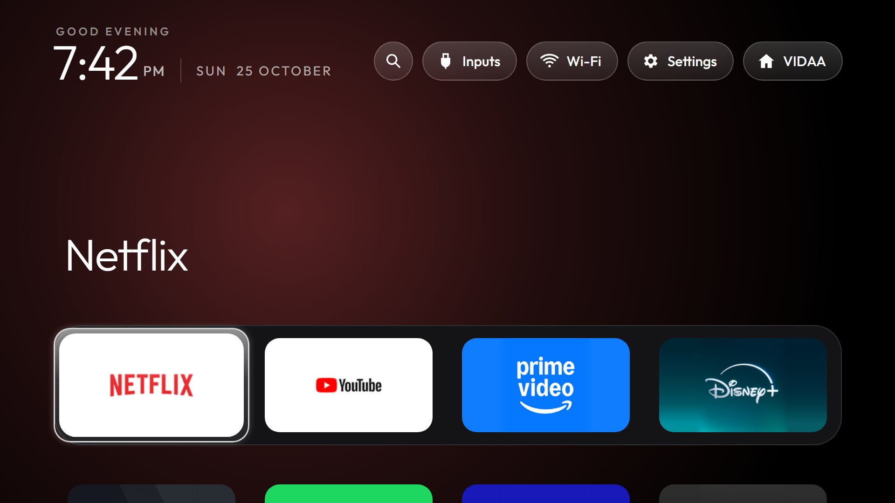
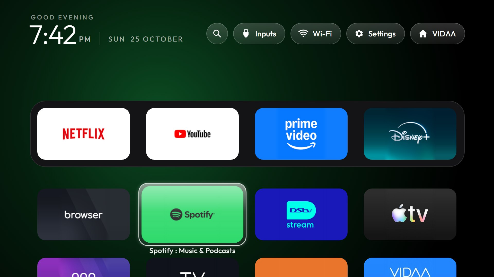
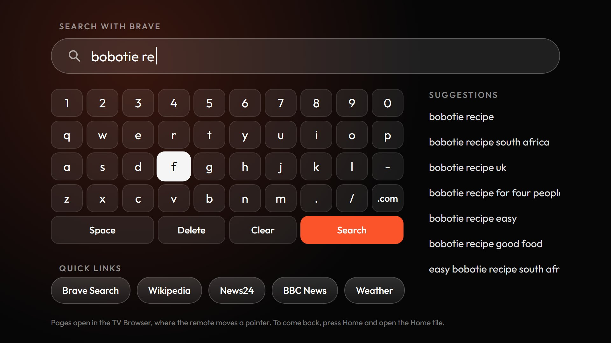
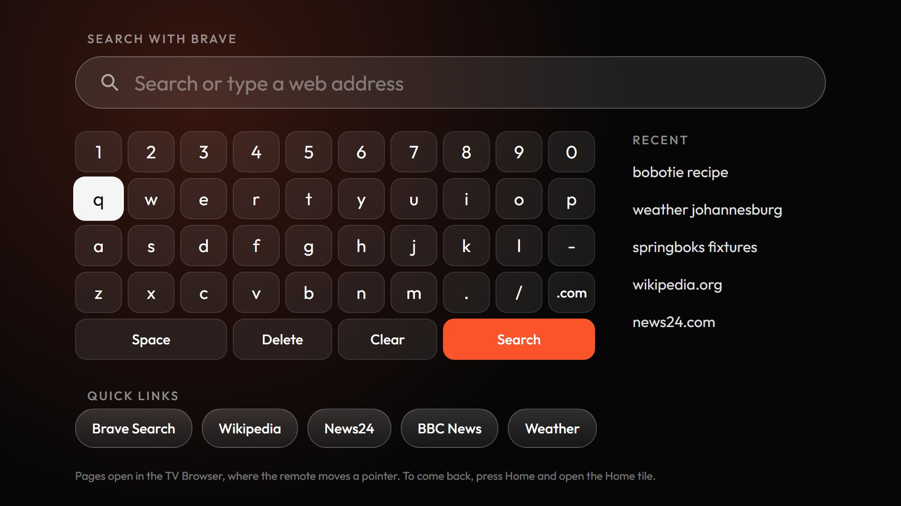
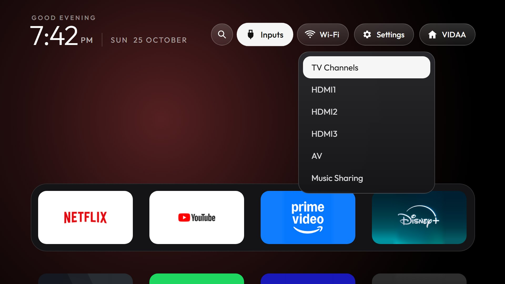
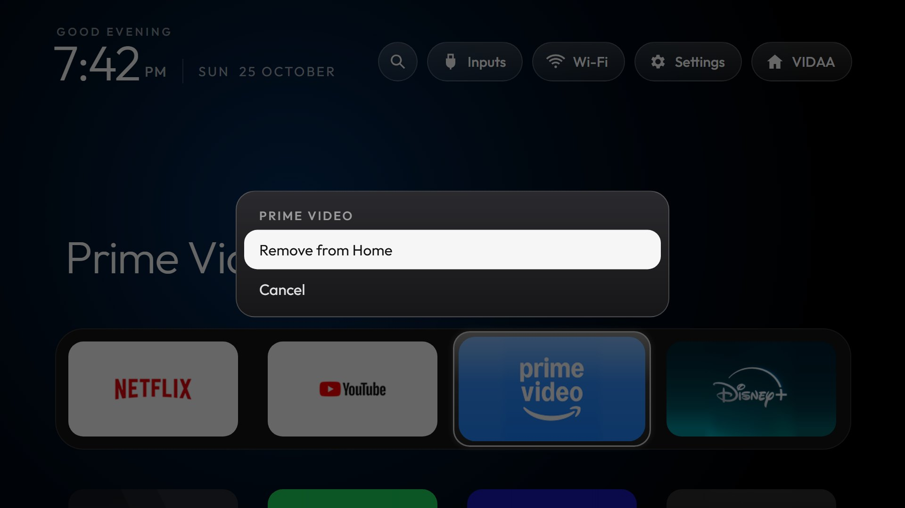
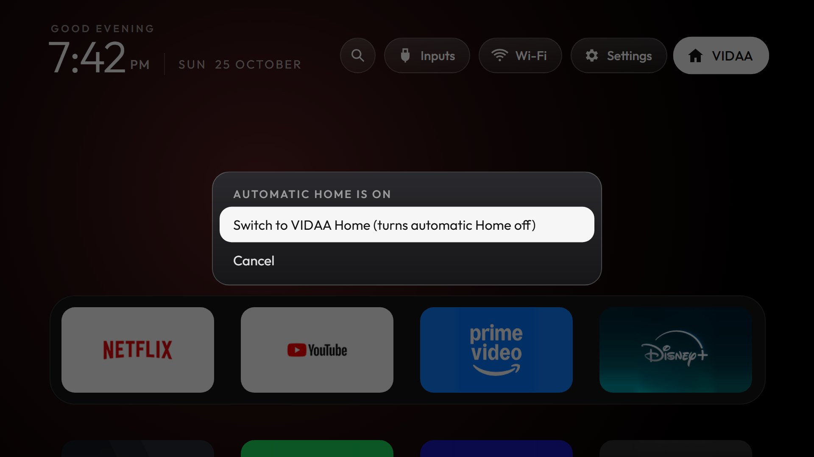
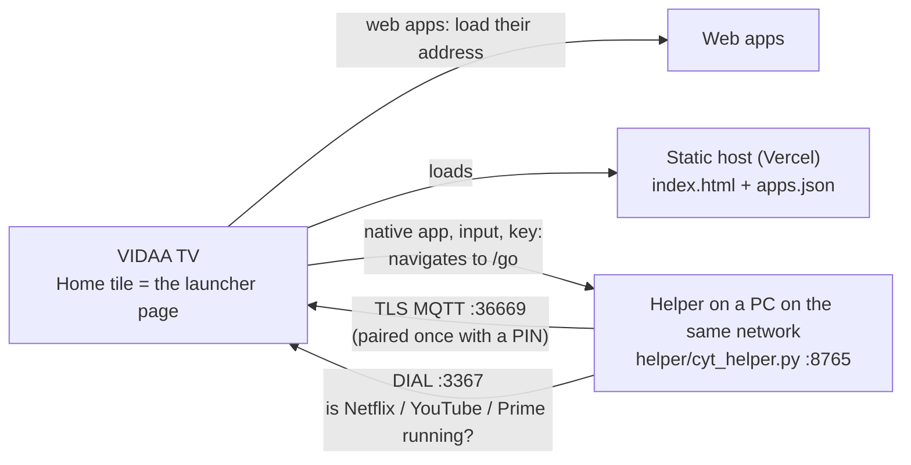

# Clean Your TV for VIDAA

A clean, Apple TV–style home screen for **Hisense VIDAA** TVs, with a black home, a four-app dock, an ambient glow in the focused app's colour and one glass highlight that springs between tiles. It is a port of the idea behind [CleanYourTV](https://github.com/Gathin23/cleanyourtv) to a TV that does not run Android.

<!-- before/after: add docs/screens/before.jpg (a photo of VIDAA's own home) and it appears on the website too -->
**Website:** [gilbertmsipha.github.io/cleanyourtv-vidaa](https://gilbertmsipha.github.io/cleanyourtv-vidaa/) · **Challenges:** [docs/CHALLENGES.md](docs/CHALLENGES.md)

<p align="center">
  
  
</p>
<p align="center">
  
  
</p>
<p align="center">
  
  
  
</p>

CleanYourTV works by talking to Android TVs over ADB: it disables junk apps and installs a new launcher. A VIDAA TV is Linux, with no ADB, no APKs and no way to replace its home screen. This project gets as close as the platform allows, using only what the TV itself offers: its web runtime, its remote-control channel and its casting service. Nothing is installed on the TV except one launcher tile, nothing is rooted or flashed, and you undo it by deleting the tile.

**Tested on** a Hisense 50A5FE (VIDAA U9, firmware V0000.09.09A.P0930, browser Chrome 111 "Odin"), October 2026. Other VIDAA TVs should behave alike, but every finding here comes from that one set; please report yours.

## What you get, and what you don't

| | Works | How |
|---|---|---|
| The CleanYourTV look | Yes | A web page drawn at 1920×1080 with the original launcher's sizes, colours, font (Outfit), glow and spring motion |
| Open web apps (Disney+, Stremio, Spotify, Plex, DStv, Apple TV…) | Yes, always | The page loads the app's own address |
| Open native apps (Netflix, YouTube 4K, Prime Video, Live TV) | With the helper | A small program on a PC on your network launches them over the TV's remote-control channel |
| Inputs menu, Settings button | With the helper | The TV's own input list; Settings sends the remote's Menu key |
| Remove apps from Home (hold OK) | Yes | Hidden from the launcher; the app stays installed |
| Home appears when the TV is switched on, and when Netflix, YouTube or Prime Video closes | With the helper | The helper watches the TV and opens the launcher (VIDAA's home flashes for ~2 s first) |
| Stremio with your addons, torrents and transcoding | With the helper | The helper serves [Stremio for VIDAA](https://github.com/NoobyGains/stremio-vidaa-tv) itself and keeps Stremio's streaming server running ([below](#stremio)) |
| A browser: search with Brave, open websites | With the helper | The Search pill (or the Browser tile) types with the remote, shows suggestions as you type, then opens the page in the TV Browser ([below](#browser)) |
| Go back to VIDAA's own home | With the helper | **VIDAA** pill: *Switch to VIDAA Home* turns the automatic Home off; the same pill turns it back on |
| Replace VIDAA's home outright | **No** | VIDAA has no setting for it; the Home button still goes to VIDAA's home |
| Disable or uninstall the TV's own apps, telemetry or ads | **No** | No ADB on VIDAA. Uninstall apps on the TV itself; see [open problems](docs/OPEN-PROBLEMS.md) for ads and tracking |

## How it works



- **The launcher** (`web/index.html`) is one self-contained page. The TV opens it as a launcher tile.
- **Without the helper** it runs from a static host such as Vercel, reads `apps.json` (your app list with precomputed colours) and opens web apps by loading their address. That keeps working when your PC is off.
- **With the helper** the Home tile's address carries `?helper=http://<pc ip>:8765`. For native apps, inputs and keys, the page *navigates* to the helper's `/go`: an https page may not call a LAN http address, but it may navigate to one. The helper does the action over the TV's remote-control channel (MQTT on port 36669, the same channel Hisense's phone app uses) and sends the browser back.
- **Home takeover:** the helper notices the TV coming on (its port 36669 answers again) and native apps closing (DIAL reports their state), then opens the launcher, served by the helper itself with the live app list.

Why it is built this way, and every dead end on the way, is in [docs/FINDINGS.md](docs/FINDINGS.md).

## What you need

- A Hisense (or other) **VIDAA** TV. Check it isn't an Android TV: if port 5555/8008/8009 are closed and 36669 and 38400 are open, and the TV's AirPlay info (`http://<tv ip>:7000/info`) says `Linux`, it is VIDAA. If it is Android, use [CleanYourTV](https://github.com/Gathin23/cleanyourtv) instead; it can do far more.
- A computer on the same network for setup: Windows, macOS or Linux, with Python 3.10+.
- For native apps and the Home takeover: a computer that stays on, such as an old laptop, a mini PC or a Raspberry Pi. A cloud server cannot do this job, because the TV only takes commands from its own network.
- Optional: a free [Vercel](https://vercel.com) account, or any static host, for the always-available page.

## Set up

### 1. Pair with the TV (once)

Pairing uses [Sidee](https://github.com/Empi9245/Sidee) (MIT), which implements VIDAA's PIN pairing and the remote-control client. It ships the client certificate that Hisense's own remote app uses; this repo does not redistribute it. Put Sidee next to this repo:

```
your-folder/
  sidee/               git clone https://github.com/Empi9245/Sidee.git sidee
  cleanyourtv-vidaa/   this repo
```

```bash
cd sidee
python -m pip install "paho-mqtt==2.1.0"
python sidee.py          # opens a dashboard: Find TV → Request code → type the PIN shown on the TV
```

Pair only; you don't need Sidee's preset tiles. The pairing is saved in `~/.sidee/session.json`. Treat that file like a password: it lets anything on your network control the TV.

### 2. Configure and start the helper

```bash
cd cleanyourtv-vidaa
cp config.example.json config.json      # set tv_name to the TV's network name
python helper/cyt_helper.py
```

On first run Windows asks whether to allow Python on the network: allow it, or the TV can't reach the helper. Open `http://localhost:8765/` in a browser: you should see the launcher with your TV's apps. `python tools/tile.py list` prints the app ids for the config:

| Config key | What it is |
|---|---|
| `dock` / `helper_dock` | The four dock apps (app ids) when the helper serves the page, and on the hosted page with a helper |
| `static_dock` | The dock on the hosted page without a helper (web apps only) |
| `native_apps` | Native apps to show when a helper can open them (Netflix `1`, Prime Video `2`, …) |
| `web_urls` / `prefer_native_with_helper` | A web version to use without the helper (YouTube → `youtube.com/tv`), and to skip when the helper is there |
| `hidden` | Apps never shown (e.g. `166`, the E-Manual) |
| `stremio` | The Stremio tile's app id, where its web app comes from, and whether the helper runs the streaming server ([below](#stremio)) |
| `browser` | Optional: the search address (`%s` is the search), the Quick links, and `region`, the [DuckDuckGo region code](https://duckduckgo.com/duckduckgo-help-pages/settings/params/) for suggestions (`za-en` South Africa, `uk-en`, `us-en`). Brave Search, five links and no region when left out |
| `launcher_url`, `launcher_origins`, `tile_icon` | Where you host the page (step 3) |

### 3. Host the page

```bash
python tools/export_static.py    # writes web/apps.json (needs the helper running)
```

Publish `web/index.html`, `web/apps.json` and `web/tile.jpg` to any static host (Vercel, Netlify, GitHub Pages). On Vercel, a `vercel.json` with `Cache-Control: no-cache` makes the TV pick up changes immediately. Put the address in `config.json` (`launcher_url`, `launcher_origins`, `tile_icon`) and restart the helper. Re-run the export after you install or uninstall apps on the TV.

### 4. Add the Home tile to the TV

```bash
python tools/tile.py add cythome "Home" \
  "https://YOUR-PROJECT.vercel.app/?helper=http%3A%2F%2F192.168.1.50%3A8765" \
  "https://YOUR-PROJECT.vercel.app/tile.jpg"
```

Use your helper computer's address in place of `192.168.1.50`. Leave out `?helper=…` for a launcher with web apps only. On the TV, move the Home tile to the first spot of VIDAA's app row, so Home → OK always gets you there.

A tile can't be changed once added (adding the same id again is ignored), so get the address right, or add a new id and delete the old tile on the TV. To remove everything, delete the tile on the TV.

### 5. Keep the helper running

- **Windows:** `powershell -ExecutionPolicy Bypass -File setup\windows\install.ps1` adds a logon task that runs it hidden and restarts it if it stops. Make sure the PC doesn't sleep.
- **Linux (systemd):** `bash setup/linux/install.sh` installs a user service that starts at boot, opens port 8765 in ufw and disables sleep, including on lid close. To move a working setup to another computer, `python setup/pack.py` makes a zip with the code, Sidee's core and the pairing. Keep that zip private.

### Browser

Brave and other browsers can't be installed on VIDAA, so the launcher has a search screen of its own that hands its results to the **TV Browser**, the browser VIDAA ships with.

**How to use it**

1. On Home, press **Up** to reach the header and pick the round **🔍** button, or open the **Browser** tile in the grid (it replaces the TV Browser's tile).
2. Type with the on-screen keyboard: arrows move, **OK** types. **Space**, **Delete**, **Clear** and **.com** are on the bottom rows. A USB keyboard, or a phone remote app's typing, types too.
3. Suggestions appear on the right as you type; with the field empty, your **Recent** searches are there instead. Press **Right** past the end of a keyboard row to reach them, **OK** to search one.
4. Press **Search**. Words open Brave Search's results; an address (`bbc.com`, `https://…`, a router's `192.168.1.1`) opens as it is.
5. **Quick links** sit below the keyboard (press **Down** past the last row).
6. The page opens in the TV Browser, where the remote moves a **pointer**: arrows move it, OK clicks, Back goes back a page.
7. To come back, press **Home** and open the **Home** tile. **Back** on the search screen closes it.

**Why it works this way**

- A page opened as an app (as the launcher is) gets only arrow-key focus, which can't click around an ordinary website. The TV Browser has a pointer, and the TV opens it at any address the helper sends (`/api/browse`, `/go?browse=`), so the launcher does the typing and the TV Browser does the browsing. That needs the helper; without one the search screen isn't shown.
- Brave Search shows few ads and doesn't profile you, which is the difference from the TV Browser's own search. The websites you then open still show their own ads: the TV Browser can't take an ad blocker, and blocking ads for the whole TV (DNS) was left out on purpose ([docs/OPEN-PROBLEMS.md](docs/OPEN-PROBLEMS.md)).
- Suggestions come from DuckDuckGo's suggestion feed (Brave's turns scripts away), through the helper (`/api/suggest`) or, on the hosted page, `hosting/api/suggest.js`, a small Vercel function: the page may not ask the feed itself (no CORS).

**Settings** (`browser` in `config.json`, all optional):

```json
"browser": {
  "search": "https://search.brave.com/search?q=%s",
  "region": "za-en",
  "links": [{"name": "Brave Search", "url": "https://search.brave.com/"}, {"name": "News24", "url": "https://www.news24.com/"}]
}
```

`search` is any search address with `%s` for the words (DuckDuckGo: `https://duckduckgo.com/?q=%s`). `region` is a [DuckDuckGo region code](https://duckduckgo.com/duckduckgo-help-pages/settings/params/) for suggestions (`za-en`, `uk-en`, `us-en`). `links` replaces the Quick links; five fit on screen. Restart the helper, and re-run `tools/export_static.py` and republish for the hosted page. Recent searches are kept in the TV browser's storage, separately for the hosted and the helper-served page.

### Stremio

The TV's Stremio is the community build [Stremio for VIDAA](https://github.com/NoobyGains/stremio-vidaa-tv); add its tile with Sidee's Stremio preset (app id `stremiodebug`). On its own it can't stream torrents or transcode: that needs Stremio's streaming server on a computer, and two things keep the TV's Stremio from using one:

- The app is served over https, and a page served over https may not call a plain-http address on the home network (mixed content).
- Stremio's server answers only pages from Stremio's own sites unless it is started with `NO_CORS=1`.

So when the `stremio` setting is present, the helper does both jobs:
- **Serves the app itself** at `http://<pc ip>:8765/stremio/`. It fetches the app from its site and keeps a copy, so updates arrive and it still opens when the internet is down.
- **Keeps the streaming server running** on port 11470 with `NO_CORS=1`. It uses Stremio desktop's own server if Stremio desktop is installed; otherwise Node.js runs a copy it downloads, which needs `node` and `ffmpeg`.

The Stremio tile opens the helper's copy, already pointed at the server. Sign in once with the QR code on the TV; your account brings your addons. Without the helper, the tile opens the app's own site, where only debrid and direct streams play.

Stremio desktop on the same computer keeps working: opened after the helper, it uses the helper's server. If Stremio desktop was opened first, its own server holds the port and keeps the TV out; close Stremio desktop, and the helper starts its server within 30 seconds.

## Using it

| Remote | On a tile | In the dock |
|---|---|---|
| Arrows | Move the glass highlight; Down slides the grid up | Up reaches Search / Inputs / Wi-Fi / Settings / VIDAA (with the helper) |
| OK | Open the app | |
| Hold OK | Menu: **Remove from Home**, **Restore removed apps** | |
| 🔍 Search | | The search screen ([Browser](#browser)) |
| VIDAA pill | | Switch back to VIDAA's own home (automatic Home off), or turn automatic Home back on. The choice is kept by the helper (`data/takeover.json`) |
| Back | Back to the dock | Stays on Home |

Removed apps are stored by the helper (`data/hidden.json`), or in the TV browser's storage on the hosted page without a helper. The remote's own Netflix/YouTube/Prime buttons work as always.

## Troubleshooting

| Symptom | Cause and fix |
|---|---|
| Native tiles show an error page | The helper isn't running or the PC is asleep. Press Back; web apps still work. |
| The helper stops being reached after a router restart | Your PC got a new address. The helper notices on start and adds a new Home tile; delete the old one. Reserving the PC's address on the router (DHCP reservation) avoids it. |
| The TV got a new address | The helper rediscovers it by `tv_name` over SSDP and updates the pairing. |
| Stremio says the streaming server is unavailable, or can't transcode | Check `data/helper.log`: Stremio desktop may have started its own server first (close it), or Node.js/ffmpeg are missing. The server's own output is in `data/stremio-server.log`. |
| Stremio has none of your addons | Sign in with the QR code: addons come with your Stremio account. The helper's copy keeps its own sign-in, separate from the app's own site. |
| Search opens a black screen that returns to Home | The TV Browser didn't open: check `data/helper.log` for `/go failed`. The helper must be running; searching needs it. |
| No suggestions while typing | The helper (or, on the hosted page, the Vercel function) can't reach DuckDuckGo. Searching still works. |
| A website can't be clicked | It opened in the launcher instead of the TV Browser, which happens only without a helper. Open it from the search screen with the helper running. |
| `the TV refused the connection` | The pairing was revoked (e.g. after a factory reset): pair again with Sidee. |
| Holding OK opens the app instead of the menu | Your remote may not repeat or release keys like ours; open an issue with what `web/probes/probe.html` records. |

The probe pages in `web/probes/` are how everything here was found. Open one on the TV with `python tools/tile.py launch cytprobe "Probe" "http://<pc ip>:8765/probes/probe.html"`; their reports land in `reports/`.

## The website

`docs/index.html` is the project's page: a before/after slider, the screens, how it works and the challenges, in the launcher's style. GitHub Pages serves it once the repository is public: **Settings → Pages → Deploy from a branch → `main`, `/docs`**. It then lives at `https://<user>.github.io/cleanyourtv-vidaa/`.

- **Before/after:** add a photo of VIDAA's own home as `docs/screens/before.jpg` (16:9, ideally 1920×1080) and the slider appears. Without it the page shows the new home alone.
- **Buy Me a Coffee and X:** fill in `coffee` and `x` in the `LINKS` block at the bottom of `docs/index.html`. Left empty, their buttons stay hidden.
- **Link previews** on X and elsewhere use `docs/screens/social.jpg` (1200×630).
- New screenshots come from the helper-served launcher in headless Chromium at 1920×1080 with demo searches; they show no addresses or accounts.

## Contributing

Read [docs/GUIDELINES.md](docs/GUIDELINES.md) first, and [docs/CHALLENGES.md](docs/CHALLENGES.md) for what was tried and why things are the way they are. The most useful contributions are tests on other VIDAA models and firmware, and progress on the [open problems](docs/OPEN-PROBLEMS.md): blocking ads and tracking safely, detecting when web apps close, and replacing VIDAA's home outright. Please never post your TV's serial number, MAC address, IP, pairing file or Wi-Fi name in issues or screenshots.

## Credits

- [CleanYourTV](https://github.com/Gathin23/cleanyourtv) by Gathin (MIT): the idea, and the launcher design and values this page reproduces
- [Sidee](https://github.com/Empi9245/Sidee) by Empi9245 (MIT): VIDAA pairing and the remote-control client this helper uses
- [vidaa-launcher](https://github.com/Zfinix/vidaa-launcher) by Zfinix (MIT): the idea of a watcher that reopens the launcher
- [Outfit](https://github.com/Outfitio/Outfit-Fonts) font (SIL Open Font License, `web/fonts/OFL.txt`)

## License

MIT, see [LICENSE](LICENSE). Not affiliated with Hisense or VIDAA; their names and app logos belong to their owners. Use it on TVs you own.
